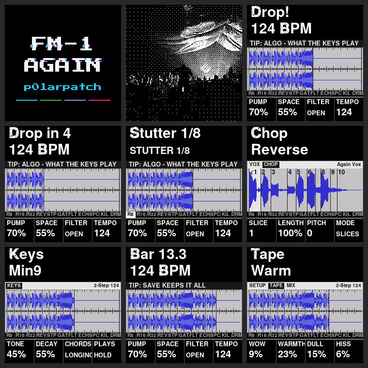

# FM-1 Again

A firmware for the M-VAVE FM-1 by PolarPatch: warm, emotional, rhythmic electronic music, made *again* on the FM-1.
Press PLAY and a garage groove starts with chords pumping under the kick. Play soft electric piano, sung syllables or
your own chopped recording on the keys, hold a black key for a stutter or a tape stop, then press ARP and let the drop
fall. A sister to [Arctic Scream p0larpatch](https://github.com/PolarPatch/Arctic-scream-FM-1).

**[Play it in the browser](https://polarpatch.github.io/FM-1-Again/)** ·
[install](https://polarpatch.github.io/FM-1-Again/install/) ·
[editor](https://polarpatch.github.io/FM-1-Again/editor/) ·
[cheat sheet](https://polarpatch.github.io/FM-1-Again/cheatsheet.html) ·
[manual](app/docs/MANUAL.md) · [demo video](https://youtu.be/FJ0DTtbBlUM) · [releases](https://github.com/PolarPatch/FM-1-Again/releases)

## What it does

- **Five things on the keys:** KEYS (a soft FM electric piano, a chord on one key), VOX (sung syllables), CHOP (your
  recording cut into slices, each one forwards or backwards), RISE (a reversed stab that ends on the beat) and DRUMS.
- **Eight grooves** with their own swing, four chord progressions in any key, **BUILD and DROP** on ARP (four styles,
  the tempo rushing into the drop) and **SONG**, a whole 72-bar track by itself.
- **PERFORM:** eleven pads on the black keys and thirteen tricks with SEL and a white key: stutters, reverse, tape
  stop, sweeps, echo and space throws, kick out.
- **PUMP** (sidechain), **SPACE**, **ECHO** (tape, ping-pong, reverse) and **TAPE**.
- A black-and-white screen set like a tour poster, the sound drawn as an audio editor draws it, and a dithered
  screensaver.
- **Ableton Link over Wi-Fi:** in time with Link apps on a phone or a computer (tempo, beat, start and stop), on
  your network or on the FM-1's own.
- **The notes to a phone:** what you play reaches apps such as Ableton Note over Bluetooth MIDI or over Wi-Fi
  (a phone's or a computer's network MIDI session), whichever you choose, or both.
- USB-MIDI, Bluetooth MIDI (and Bluetooth MIDI devices), USB audio, a screen reader, the settings kept through
  updates, backup, and an editor page for every value and CHOP's sample.

## Install

In Chrome or Edge, with the FM-1 on USB: [the installer](https://polarpatch.github.io/FM-1-Again/install/). It can
also put M-VAVE's own firmware back. Or from a terminal, with the package from the releases:

    pip install mido python-rtmidi
    python3 base/tools/fm1_install.py again-1.0.7.fwsc

Unofficial firmware, not made or endorsed by M-VAVE: install at your own risk. Stuck? The Rescue page on the
[FM-1 Firmware Hub](https://thefirmwarehub.com/) brings it back.

**Back up first: other firmwares' projects and samples.** FM-1 Again cannot read what another firmware saved, and it
writes over these parts of the FM-1's flash: 0x97000–0xDBFFF (the screensaver's film, written by the installer), the
store's pairs at 0xDC000 and 0xDE000, 0xE5000–0xFBFFF (CHOP's sample) and Felucca's settings sector pair at 0xFC000
(FM-1 Again's settings). Samples, kits or projects another firmware kept there are gone after you install it, and a
firmware you install afterwards will not find FM-1 Again's settings or sample. Back up with that firmware's own tool
before you install.

## Your own sample

CHOP holds one recording of up to 8 seconds. Record or open one in [the editor](https://polarpatch.github.io/FM-1-Again/editor/),
or from a terminal:

    python3 app/tools/again_chop.py my-voice.wav --send

## Build

    git clone --recursive https://github.com/PolarPatch/FM-1-Again
    ./build.sh                    # app/build/again.fwsc
    ./build.sh --host             # the host simulator; tests: sh tests/run_tests.sh
    ./build.sh --web              # the browser emulator (Emscripten)

fm1-base's [README](base/README.md) has the toolchain. The site: `app/tools/make_again_site.py VERSION`.

## Credits and licence

FM-1 Again by PolarPatch is built on [fm1-base](https://github.com/charlesvestal/fm1-base) (Charles Vestal, MPL-2.0)
and felucca-bsp, from [Felucca](https://github.com/hugelton/Felucca) by Leo Kuroshita (Hügelton Instruments). Its
SPACE, ECHO and TAPE come from Arctic Scream, which took them from Felucca and GR!MM. The pads, tabs, SONG and builds
follow ideas of [loaf-breaker](https://github.com/FLEXOR-R/loaf-breaker) by FLEXOR, written anew.

Its Wi-Fi stack and Ableton Link (a C port of Ableton's Link library) are fm1-base's, by Henri David from
[Optimist](https://github.com/w0ts/optimist). Ableton Link is a trademark of Ableton AG; FM-1 Again is not made or
endorsed by Ableton.

The firmware is GPL-3.0-only ([LICENSE](LICENSE)); every part and its licence is in [LICENSING.md](LICENSING.md).

The look follows the posters of the USB002 tour, and the screensaver's film (`app/media/`) is footage from it, both
from the creative files its team shared with the community; they are not under the GPL and are not this project's
branding. **FM-1 Again is not made, endorsed or approved by any artist**, and is not affiliated with M-VAVE.

Free, and always will be. [Buy PolarPatch a coffee](https://buymeacoffee.com/p0larpatch).
